# Canny Edge Detection — 엣지 검출 기초 실습

> OpenCV의 `cv.Canny`와 `cv.findContours`로 **임계값(Tlow/Thigh)** 과 **윤곽 길이 기준**이 결과를 어떻게 바꾸는지 직접 측정하고 해석한 기초 실습입니다.

| 항목 | 내용 |
|---|---|
| 목적 | 엣지 검출 원리 이해, 파라미터가 결과에 미치는 영향을 수치로 확인 |
| 환경 | Python 3.12 · OpenCV (`opencv-python`) · NumPy · VS Code |
| 입력 | 직접 촬영한 벽돌 건물 사진 (`docs/images/structure_1.jpg`, 4000 × 6000 px) |
| 출력 | `output/` 폴더의 엣지 맵, 윤곽선 합성 이미지 |

---

## 1. 엣지란 무엇이고 왜 중요한가

**엣지(edge)** 는 영상에서 밝기가 급격히 변하는 경계입니다. 물체와 배경의 경계, 창문 테두리, 글자의 획이 대표적입니다.

엣지가 중요한 이유는 세 가지입니다.

1. **정보 압축**: 모든 픽셀 대신 경계선만 남기면 데이터는 크게 줄지만 물체의 형태는 유지됩니다. 이번 실습의 Canny(100, 200) 결과에서 엣지 픽셀은 전체의 약 5.6%였습니다.
2. **형태 정보의 출발점**: 윤곽선, 직선, 원, 모서리 같은 상위 특징은 대부분 엣지에서 출발합니다.
3. **조명 변화에 비교적 강한 단서**: 색이나 밝기 값 자체보다 "어디에서 바뀌는가"를 보므로 구조를 비교하기 쉽습니다. 다만 아래 한계에서 보듯 질감과 노이즈에는 약합니다.

## 2. 엣지 처리 방법의 종류

| 방법 | 원리 | 장점 | 단점 |
|---|---|---|---|
| Roberts / Prewitt / Sobel | 1차 미분 마스크로 x, y 방향 기울기(gradient) 계산 | 간단하고 빠름, Sobel은 약한 블러 효과 포함 | 선이 두껍고 임계값 선택에 민감 |
| Scharr | Sobel을 개선한 3×3 미분 마스크 | 방향 정확도가 더 좋음 | 노이즈에 여전히 민감 |
| Laplacian / LoG | 2차 미분, 영교차(zero-crossing) 검출 | 방향에 무관하게 검출 | 노이즈에 매우 민감 (LoG는 블러를 먼저 적용해 완화) |
| **Canny** | 기울기 계산 → 비최대 억제 → 이중 임계값 → 히스테리시스 | 선이 가늘고 연결성이 좋으며, 약한 엣지와 강한 엣지를 구분 | 파라미터(Tlow, Thigh)와 사전 블러에 결과가 크게 좌우됨 |

### Canny 알고리즘 단계

1. **노이즈 제거**: 가우시안 블러 (※ OpenCV의 `cv.Canny`는 내부에서 블러를 하지 않으므로 필요하면 직접 `cv.GaussianBlur`를 적용해야 합니다)
2. **기울기 계산**: Sobel로 기울기 크기와 방향 산출
3. **비최대 억제(NMS)**: 기울기 방향에서 가장 큰 픽셀만 남겨 선을 1픽셀 두께로 가늘게 함
4. **이중 임계값**: `기울기 ≥ Thigh` 는 확실한 엣지, `기울기 < Tlow` 는 제거, 그 사이는 "후보"
5. **히스테리시스**: 후보는 확실한 엣지와 이어져 있을 때만 유지

## 3. 어디에 활용되는가

- **차선 검출**: Canny로 경계를 추출한 뒤 Hough 변환으로 직선 검출
- **문서 스캔**: 종이의 외곽선을 찾아 원근 보정
- **물체 윤곽 · 치수 측정**: `findContours`로 윤곽을 얻어 면적, 둘레, 형태 분석
- **산업 · 의료 검사**: 부품의 균열, 결함 경계, 장기 · 병변의 경계 추출 전처리
- **인식 · 분할 전처리**: 객체 검출이나 분할 모델 앞단의 특징 추출

---

## 4. 실습 내용

### 4.1 실습 1 — 임계값 비교 (`01_canny_threshold_compare.py`)

같은 그레이 영상에 두 가지 임계값 쌍을 적용해 엣지 양이 어떻게 달라지는지 비교했습니다.

```python
import cv2 as cv
import os

base = os.path.dirname(os.path.abspath(__file__))
out_dir = os.path.join(base, 'output')
os.makedirs(out_dir, exist_ok=True)

img = cv.imread(os.path.join(base, 'docs', 'images', 'structure_1.jpg'))
if img is None:
    raise FileNotFoundError('docs/images/structure_1.jpg를 읽을 수 없습니다.')

gray = cv.cvtColor(img, cv.COLOR_BGR2GRAY)
canny1 = cv.Canny(gray, 50, 150)    # Tlow=50,  Thigh=150
canny2 = cv.Canny(gray, 100, 200)   # Tlow=100, Thigh=200

cv.imwrite(os.path.join(out_dir, '01_original_gray_structure_1.png'), gray)
cv.imwrite(os.path.join(out_dir, '01_canny1_50_150_structure_1.png'), canny1)
cv.imwrite(os.path.join(out_dir, '01_canny2_100_200_structure_1.png'), canny2)
```

| 설정 | 엣지 픽셀 수 | 전체 대비 |
|---|---:|---:|
| Canny (50, 150) | 1,788,674 | 7.45% |
| Canny (100, 200) | 1,350,354 | 5.63% |

임계값을 올리자 엣지 픽셀이 약 **24.5% 감소**했습니다. 사라진 엣지는 주로 소나무 잎과 벽돌 줄눈처럼 대비가 약한 부분이었습니다. 건물 외곽, 창틀, 간판 글자처럼 대비가 강한 엣지는 두 설정 모두에서 유지됐습니다.

| 그레이 원본 | Canny (50, 150) | Canny (100, 200) |
|---|---|---|
| 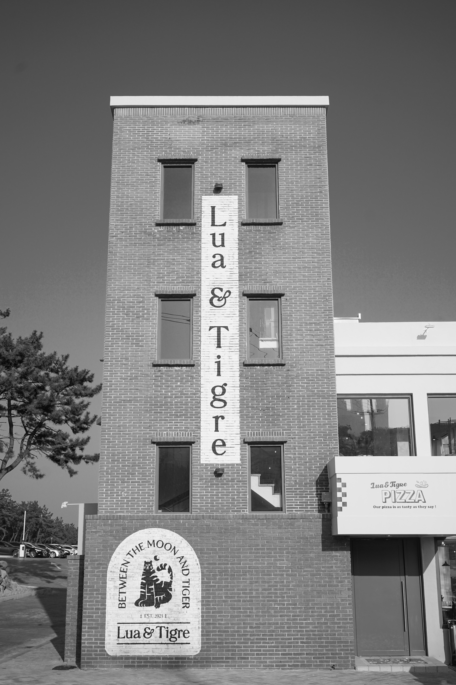 | 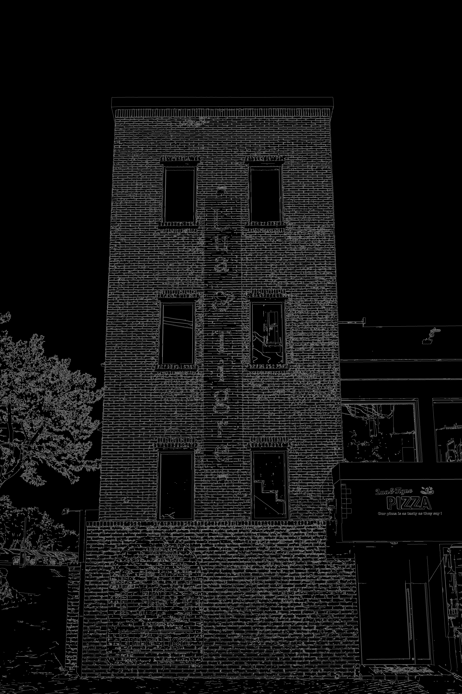 | 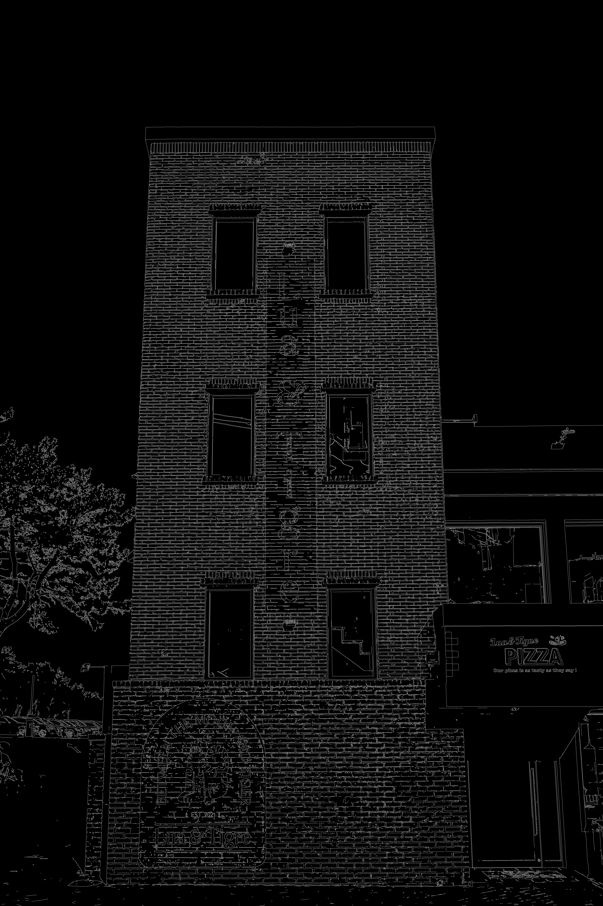 |

### 4.2 실습 2 — 윤곽선 검출과 길이 필터링 (`02_canny_contour_filter.py`)

Canny 결과에서 `findContours`로 윤곽을 찾고, 점 개수가 기준보다 긴 윤곽만 초록색으로 그렸습니다. 기준값을 100, 300, 500으로 바꿔 비교했습니다.

```python
import cv2 as cv
import os

base = os.path.dirname(os.path.abspath(__file__))
out_dir = os.path.join(base, 'output')
os.makedirs(out_dir, exist_ok=True)

img = cv.imread(os.path.join(base, 'docs', 'images', 'structure_1.jpg'))
if img is None:
    raise FileNotFoundError('docs/images/structure_1.jpg를 읽을 수 없습니다.')

gray = cv.cvtColor(img, cv.COLOR_BGR2GRAY)
canny = cv.Canny(gray, 100, 200)
contour, hierarchy = cv.findContours(canny, cv.RETR_LIST, cv.CHAIN_APPROX_NONE)

cv.imwrite(os.path.join(out_dir, '02_canny_structure_1.png'), canny)

for min_len in [100, 300, 500]:           # 비교할 길이 기준값
    lcontour = [c for c in contour if c.shape[0] > min_len]
    result = img.copy()                   # 매번 원본 복사본에 그림 (선이 누적되지 않도록)
    cv.drawContours(result, lcontour, -1, (0, 255, 0), 3)
    cv.imwrite(os.path.join(out_dir, f'02_contours_len{min_len}_structure_1.png'), result)
    print(f'기준 {min_len}: 윤곽 {len(lcontour)}개')
```

| 길이 기준 | 남은 윤곽 수 | 전체(27,360개) 대비 |
|---|---:|---:|
| 필터 없음 | 27,360 | 100% |
| > 100 | 4,776 | 17.5% |
| > 300 | 1,524 | 5.6% |
| > 500 | 806 | 2.9% |

> 수치는 `02_canny_structure_1.png`(Canny 100, 200 결과)에 위 코드와 같은 `findContours` 설정을 적용해 다시 센 값입니다.

| 길이 > 100 | 길이 > 300 | 길이 > 500 |
|---|---|---|
| 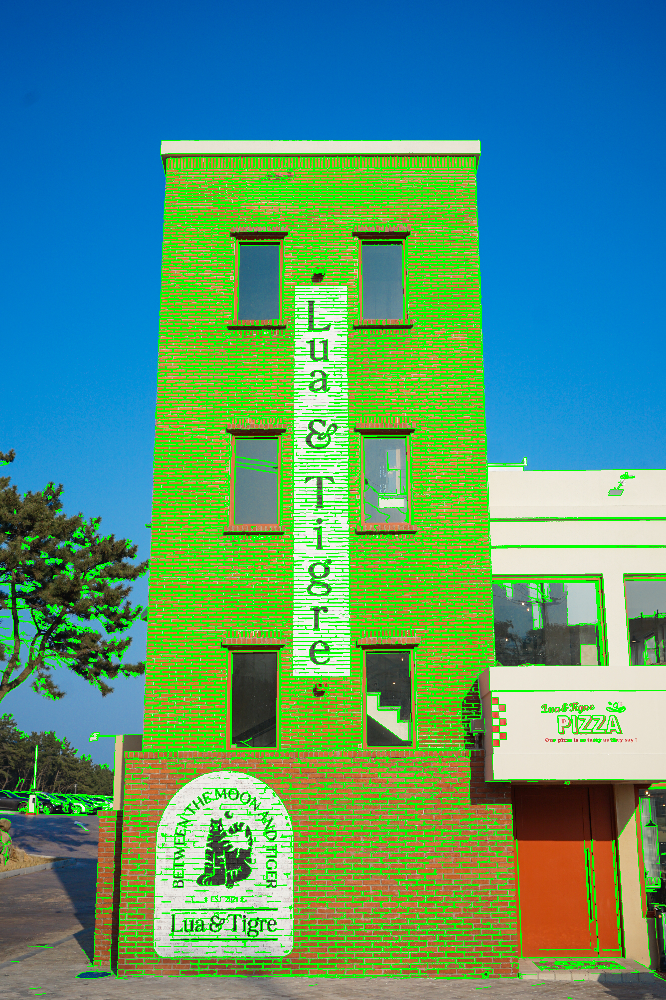 | 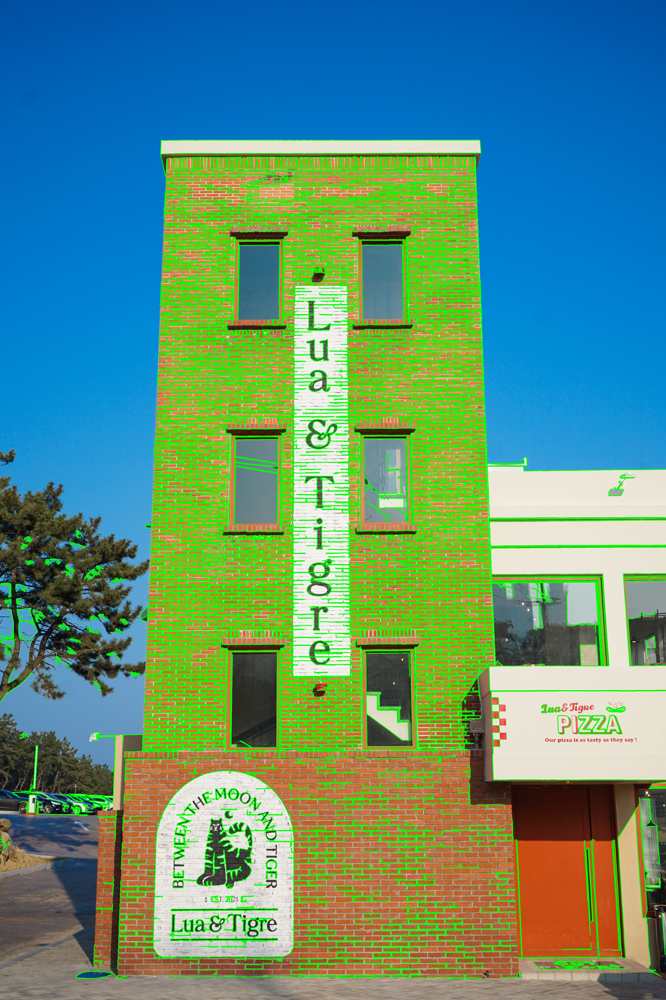 |  |

---

## 5. 결과 해석

- **임계값은 "얼마나 약한 엣지까지 허용하는가"를 정합니다.** 50/150은 질감까지 많이 잡고, 100/200은 구조적인 엣지 위주로 남습니다.
- **길이 필터는 짧은 조각 노이즈를 줄이는 데 효과적이었습니다.** 기준 100만 적용해도 윤곽 수가 27,360개에서 4,776개로 줄었고, 500에서는 806개가 남았습니다.
- **그러나 벽돌 벽에서는 길이 필터만으로 질감을 제거하지 못했습니다.** 벽돌 줄눈이 서로 이어져 긴 윤곽 하나로 잡히기 때문에, 기준을 500으로 올려도 벽면에 초록 윤곽이 많이 남았습니다. 길이 기준은 "짧은 노이즈"에는 맞지만 "반복되는 긴 질감"에는 맞지 않습니다.

## 6. 한계와 다음 단계

| 한계 | 원인 | 다음 시도 |
|---|---|---|
| 벽돌 줄눈, 나뭇잎 엣지가 많이 남음 | `cv.Canny` 전에 가우시안 블러를 적용하지 않음 | `cv.GaussianBlur` 커널 크기별(3, 5, 9) 비교 |
| 길이 기준이 해상도에 종속됨 | 윤곽 길이는 픽셀 단위 (4000 × 6000 기준값) | 영상 대각선 길이의 비율로 기준 정의 |
| 벽 전체가 하나의 질감 영역으로 칠해짐 | `RETR_LIST`는 모든 윤곽을 반환 | `RETR_EXTERNAL`, 면적(`cv.contourArea`) 조건, 모폴로지 연산 병행 |
| 임계값을 눈으로만 고름 | 정량 기준 없음 | 이미지 중앙값 기반 자동 임계값(`median ± 33%`) 비교 |

참고: 윤곽 길이는 윤곽을 이루는 점의 개수입니다. 1픽셀 두께의 선은 양쪽 면을 따라 한 바퀴 돌기 때문에 실제 선 길이의 약 2배로 계산됩니다.

## 7. 실행 방법

```bash
python -m pip install opencv-python numpy
python 01_canny_threshold_compare.py
python 02_canny_contour_filter.py
```

폴더 구조:

```
Open_CV/
├─ docs/images/structure_1.jpg
├─ 01_canny_threshold_compare.py
├─ 02_canny_contour_filter.py
├─ output/            # 실행 결과 저장
└─ README.md
```

---
---

# Hough Transform — 원과 직선 검출 기초 실습

> OpenCV의 `cv.HoughCircles`와 `cv.HoughLinesP`로 **원(동전)** 과 **직선(건물)** 을 검출하고, 투표 기준값이 **오검출과 놓침**을 어떻게 바꾸는지 측정한 기초 실습입니다. 엣지 검출(Canny) 실습의 다음 단계입니다.

| 항목 | 내용 |
|---|---|
| 목적 | 허프 변환 원리 이해, 기준값(`param2`, `threshold`, `minLineLength`)이 결과에 미치는 영향 확인 |
| 환경 | Python 3.12 · OpenCV (`opencv-python`) · NumPy · VS Code |
| 입력 | 원: 동전 사진 `docs/images/coin.png` (Pexels 무료 이미지) / 직선: 직접 촬영한 벽돌 건물 사진 `docs/images/structure_1.jpg` |
| 출력 | `output/` 폴더의 원·직선 검출 결과 이미지 |

---

## 8. 허프 변환이란

영상에서 **직선, 원 같은 도형을 투표 방식으로 찾는 방법**입니다. 엣지 점 하나하나가 "내가 이 도형 위에 있다면 도형의 파라미터는 무엇인가"를 계산해 파라미터 공간에 표를 던지고, **표가 가장 많이 모인 파라미터를 도형으로 인정**합니다.

| 도형 | 파라미터 | 설명 |
|---|---|---|
| 직선 | (ρ, θ) 2개 | `ρ = x·cosθ + y·sinθ` 로 표현. 같은 직선 위의 점들은 같은 (ρ, θ)에 투표 |
| 원 | 중심 (a, b), 반지름 r 3개 | 3차원 투표는 무겁기 때문에 OpenCV의 `HOUGH_GRADIENT`는 엣지의 기울기 방향을 이용해 **중심을 먼저 찾고 반지름을 나중에 정함** |

일부가 가려지거나 끊긴 도형도 나머지 점들의 표만 충분하면 검출할 수 있다는 점이 장점입니다.

## 9. 사용한 함수

| 함수 | 입력 | 핵심 파라미터 |
|---|---|---|
| `cv.HoughCircles` | 그레이 영상 (내부에서 Canny 수행) | `param1`: 내부 Canny의 높은 임계값(낮은 값은 그 절반), `param2`: 원으로 인정할 투표 임계값, `minDist`, `minRadius`, `maxRadius` |
| `cv.HoughLinesP` | **Canny 엣지 맵** | `threshold`: 직선으로 인정할 투표 수, `minLineLength`: 최소 선분 길이, `maxLineGap`: 같은 선으로 잇는 최대 간격 |

(`cv.HoughLines`는 무한 직선의 (ρ, θ)를, `cv.HoughLinesP`는 선분의 양 끝점을 반환합니다.)

## 10. 어디에 활용되는가

- **차선 검출**: Canny + `HoughLinesP`로 도로의 직선 추출
- **문서 · 건물 외곽 검출**: 긴 직선을 찾아 기울기 보정, 원근 보정
- **개수 세기 · 위치 파악**: 동전, 나사, 구멍 같은 원형 부품 검출
- **산업 검사**: 원형 부품의 위치와 크기 확인, 직선 가장자리 정렬 검사

---

## 11. 실습 내용

### 11.1 공통 전처리

두 코드 모두 이미지를 **가로 1200px로 줄여서** 처리합니다. 반지름과 선 길이 기준은 픽셀 단위라 해상도에 종속되기 때문입니다.

### 11.2 실습 3 — 원 검출 (`03_hough_circles.py`)

동전 사진에 `medianBlur`를 적용한 뒤 `param2`를 20, 30, 40, 50으로 바꿔 비교했습니다.

```python
blur = cv.medianBlur(gray, 5)
circles = cv.HoughCircles(blur, cv.HOUGH_GRADIENT, 1, 40,
                          param1=100, param2=param2,
                          minRadius=30, maxRadius=75)
```

| param2 | 검출된 원 개수 | 관찰 |
|---:|---:|---|
| 20 | 124 | 동전 더미 위에 겹친 원이 폭증 (오검출) |
| 30 | 61 | 여전히 겹친 원이 많음 |
| 40 | 39 | 떨어진 동전은 대부분 검출 |
| 50 | 20 | 오검출은 줄지만 실제 동전을 놓침 |

> 개수는 결과 이미지의 중심점을 센 값입니다. 터미널에 출력된 값과 다르면 터미널 값을 우선하세요.

| param2 = 20 | param2 = 30 | param2 = 40 | param2 = 50 |
|---|---|---|---|
|  |  |  |  |

### 11.3 실습 4 — 직선 검출 (`04_hough_lines.py`)

건물 사진을 `GaussianBlur` 후 Canny(100, 200)로 엣지 맵을 만들고, `HoughLinesP` 기준값을 바꿔 비교했습니다.

```python
blur = cv.GaussianBlur(gray, (5, 5), 0)
edge = cv.Canny(blur, 100, 200)
lines = cv.HoughLinesP(edge, 1, np.pi / 180, threshold,
                       minLineLength=min_len, maxLineGap=10)
```

| threshold | minLineLength | 검출된 직선 수 | 관찰 |
|---:|---:|---:|---|
| 50 | 30 | 681 | 소나무, 로고, 글자 획에 잔선과 오검출 |
| 80 | 60 | 186 | 건물 외곽, 창틀 위주로 정리됨 |
| 100 | 100 | 79 | 가장 깔끔하지만 짧은 실제 선은 제외됨 |

**블러 효과**: Canny 엣지 픽셀이 블러 없이 **260,123개**, 블러 적용 시 **70,554개**로 약 **72.9% 감소**했습니다. Canny 실습에서 벽돌 줄눈과 나뭇잎 엣지가 많이 남았던 원인이 블러 미적용이었다는 가설을 수치로 확인했습니다.

| 블러 없음 엣지 | 블러 적용 엣지 |
|---|---|
| 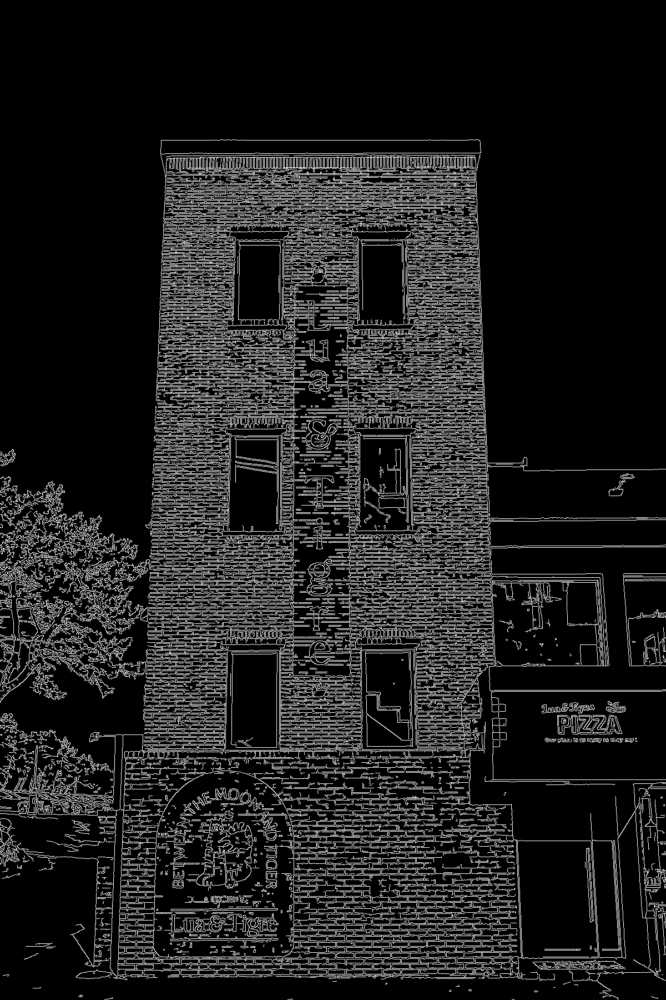 | 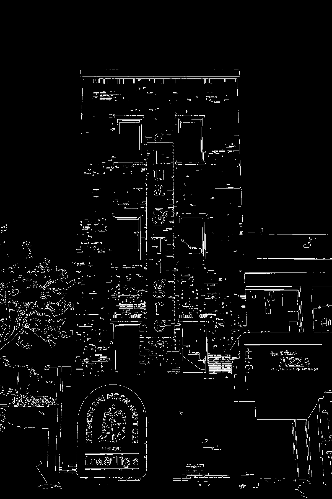 |

| threshold 50 / 길이 30 | threshold 80 / 길이 60 | threshold 100 / 길이 100 |
|---|---|---|
| 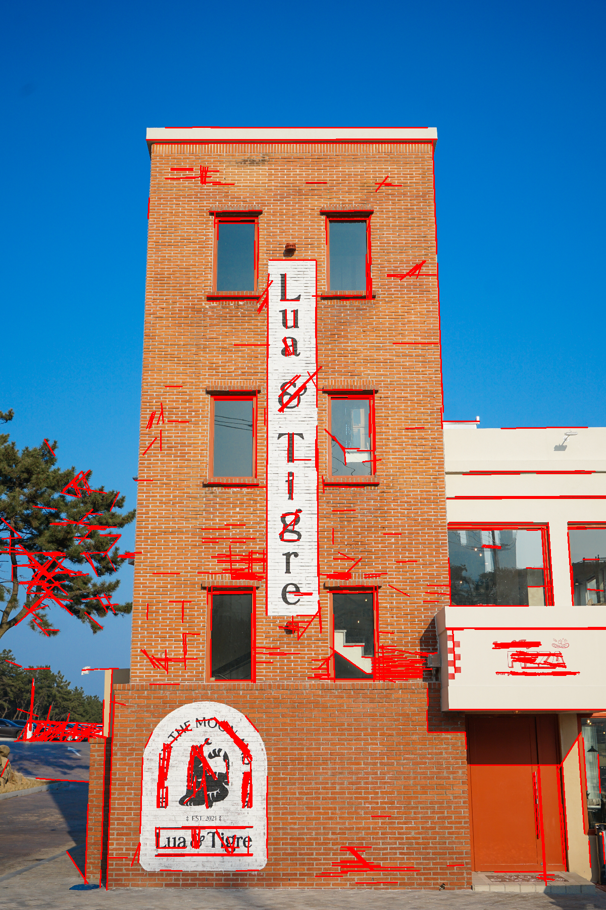 | 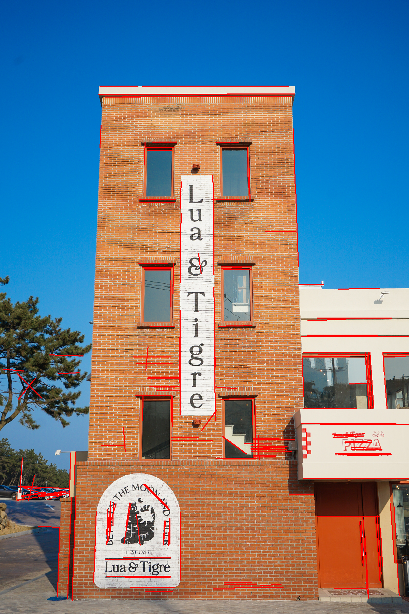 | 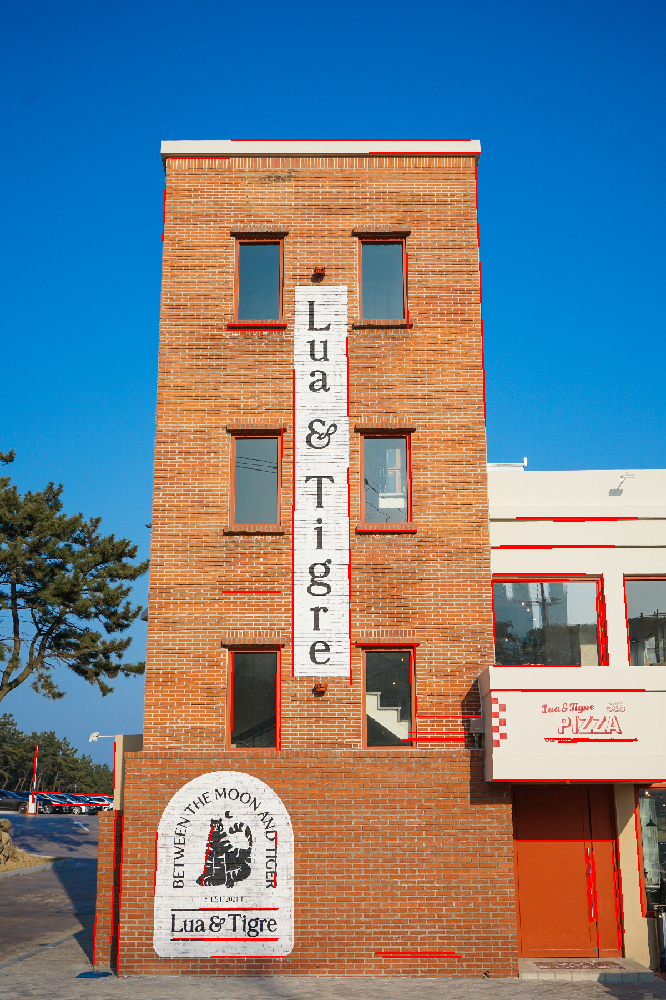 |

---

## 12. 결과 해석

- **투표 기준값은 "오검출을 감수할지, 놓침을 감수할지"의 선택입니다.** 원 검출은 `param2`가 낮으면 후보가 폭증하고, 높으면 실제 동전을 놓칩니다. 이 사진에서는 40 부근이 균형점이었습니다.
- **직선 검출은 기준값을 올릴수록 구조적인 선만 남습니다.** `threshold` 80~100에서 건물 외곽과 창틀이 남고 소나무와 로고의 잔선이 사라졌습니다.
- **전처리가 결과를 좌우합니다.** 블러 하나로 엣지 픽셀이 72.9% 줄어, 같은 허프 변환이라도 입력 엣지 맵의 품질이 결과를 결정한다는 점을 확인했습니다.

## 13. 한계와 다음 단계

| 한계 | 원인 | 다음 시도 |
|---|---|---|
| 겹쳐 쌓인 동전은 어떤 값에서도 불완전 | 동전이 일부만 보여 원 전체의 테두리 투표가 부족 | 겹침이 없는 사진으로 재측정, 정확도(실제 개수 대비) 계산 |
| 동전 크기가 제각각이라 반지름 범위(30~75px)가 넓음 | 여러 나라 동전이 섞여 있음 | 같은 종류 동전 사진으로 `minRadius`/`maxRadius` 좁히기 |
| 원형이 아닌 동전(7각형 50p)은 높은 `param2`에서 빠짐 | 원 모델에 맞지 않음 | 윤곽선 기반 방법(`findContours` + 원형도)과 비교 |
| 직선 기준값을 눈으로 고름 | 정량 기준 없음 | 직선을 직접 라벨링해 정밀도·재현율 비교 |
| 개수가 검출 수일 뿐 "정답 수"와 비교하지 못함 | 정답 라벨이 없음 | 동전 개수를 세어 기준값별 오차 계산 |

## 14. 실행 방법

```bash
python -m pip install opencv-python numpy
python 03_hough_circles.py
python 04_hough_lines.py
```

폴더 구조:

```
Open_CV/
├─ docs/images/coin.png
├─ docs/images/structure_1.jpg
├─ 03_hough_circles.py
├─ 04_hough_lines.py
├─ output/            # 실행 결과 저장
└─ README.md
```

## 이미지 출처

- 동전 사진: Pexels 무료 이미지
- 건물 사진: 직접 촬영

---
---

# Adaptive Threshold — 영상 이진화 기초 실습

> OpenCV의 `cv.threshold`(고정값, Otsu)와 `cv.adaptiveThreshold`를 같은 사진에 적용해 비교하고, **그림자 강도를 바꿔 가며** 적응형 임계값이 언제 도움이 되는지 수치로 확인한 기초 실습입니다.

| 항목 | 내용 |
|---|---|
| 목적 | 전역 임계값과 적응형 임계값의 차이 이해, `blockSize`와 `C`가 결과에 미치는 영향 확인 |
| 환경 | Python 3.12 · OpenCV (`opencv-python`) · NumPy · VS Code |
| 입력 | 채용박람회 안내 책자 사진 `docs/images/document.jpg` (표 안쪽의 약한 그림자 포함) |
| 출력 | `output/` 폴더의 이진화 결과 이미지와 `06_synthetic_shadow_scores.csv` |

---

## 15. 영상 이진화와 임계값

이진화는 영상을 **검정과 흰색 두 값으로 나누는 처리**입니다. 글자 추출, 문서 스캔, 물체 분리처럼 "무엇이 대상이고 무엇이 배경인가"를 가르는 전처리로 많이 쓰입니다. 기준이 되는 밝기(임계값)를 어떻게 정하느냐가 결과를 좌우합니다.

| 방법 | 임계값을 정하는 방식 | 장점 | 약점 |
|---|---|---|---|
| 고정값 (`THRESH_BINARY`) | 사람이 정한 값 하나 (예: 127) | 단순하고 빠름 | 조명이 바뀌면 바로 깨짐 |
| Otsu (`THRESH_OTSU`) | 영상 전체의 히스토그램으로 최적값 하나를 자동 계산 | 값을 직접 고르지 않아도 됨 | 여전히 영상 전체에 임계값 하나 |
| 적응형 (`adaptiveThreshold`) | **픽셀마다** 주변 `blockSize × blockSize` 영역의 평균(또는 가우시안 가중 평균)에서 `C`를 뺀 값 | 그림자, 조명 불균일에 강함 | 속이 찬 큰 영역은 윤곽만 남을 수 있고, `C`에 민감 |

## 16. 사용한 함수

```python
# 전역
cv.threshold(gray, 127, 255, cv.THRESH_BINARY)
cv.threshold(gray, 0, 255, cv.THRESH_BINARY + cv.THRESH_OTSU)

# 적응형
cv.adaptiveThreshold(gray, 255, cv.ADAPTIVE_THRESH_GAUSSIAN_C,
                     cv.THRESH_BINARY, blockSize, C)
```

| 파라미터 | 의미 |
|---|---|
| `ADAPTIVE_THRESH_MEAN_C` / `GAUSSIAN_C` | 주변 영역의 단순 평균 / 중심에 가중치를 둔 가우시안 평균 |
| `blockSize` | 주변 영역의 한 변 길이 (홀수). 글자보다 충분히 커야 함 |
| `C` | 평균에서 뺄 상수. 작으면 잡음, 크면 획이 약해짐 |

## 17. 어디에 활용되는가

- **문서 스캔, OCR 전처리**: 책상 위 사진처럼 한쪽이 어두운 문서에서 글자 추출
- **QR코드, 바코드 판독**: 조명이 고르지 않은 환경에서 패턴 분리
- **산업 검사**: 조명이 균일하지 않은 라인에서 결함, 마킹 검출
- **현미경, 의료 영상**: 배경 밝기가 완만하게 변하는 영상에서 대상 분리

---

## 18. 실습 내용

### 18.1 전처리

두 코드 모두 이미지를 **가로 1500px로 줄여서** 처리합니다. `blockSize`는 픽셀 단위라 해상도에 종속되기 때문입니다.

### 18.2 실습 5 — 방법과 파라미터 비교 (`05_adaptive_threshold.py`)

같은 사진에 고정값 127, Otsu, 적응형(평균/가우시안, `blockSize` 31, `C` 10)을 적용했습니다. 이어서 `blockSize`를 11, 31, 51, 101로, `C`를 2, 10, 20으로 바꾸며 확대 구간을 비교했습니다.

| 방법 | 전체 사진의 검은 픽셀 비율 |
|---|---:|
| 고정 127 (= Otsu 127) | 32.4% |
| adaptive 평균 | 12.3% |
| adaptive 가우시안 | 9.6% |

> Otsu가 고른 임계값이 127이어서 고정값 127과 결과가 완전히 같습니다. 이 사진의 그림자가 약하다는 뜻입니다.

| `C` (가우시안, `blockSize` 31) | 2 | 10 | 20 |
|---|---:|---:|---:|
| 확대 구간 검은 픽셀 비율 | 26.3% | 12.3% | 10.5% |

| 고정 127 = Otsu | adaptive 평균 | adaptive 가우시안 | 가우시안 `C`=2 |
|---|---|---|---|
| 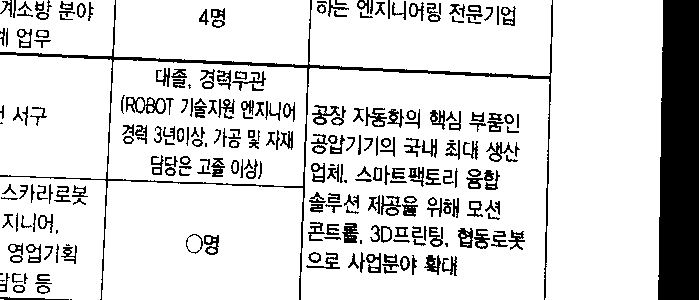 | 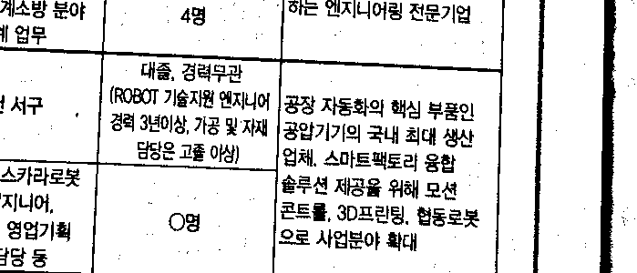 | 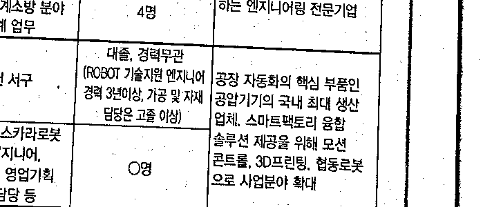 | 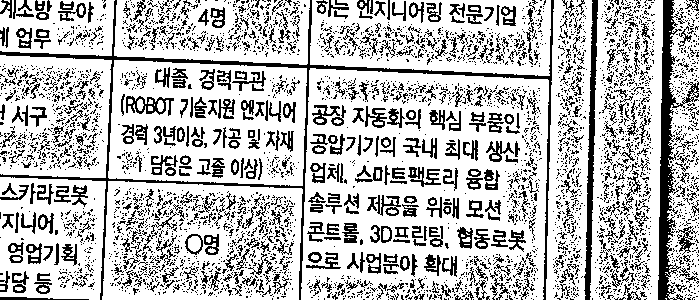 |

**관찰**
- 이 사진에서는 전역 방법도 글자를 읽을 수 있습니다. 그림자가 약해서 **원본만으로는 적응형의 이점이 크게 보이지 않습니다.**
- 전역 방법은 왼쪽 위의 어두운 배경이 검은 덩어리로 남고, 적응형은 이를 흰색으로 정리합니다.
- 반대로 적응형은 남색 머리글 칸과 일러스트의 속이 비고 윤곽만 남습니다. 어두운 면적이 큰 대상에는 불리합니다.
- `C`=2에서는 종이 질감이 잡음으로 검출됩니다.

### 18.3 실습 6 — 합성 그림자 비교 (`06_synthetic_shadow.py`)

원본의 그림자가 약해서 차이가 안 보이므로, **같은 사진에 오른쪽으로 갈수록 어두워지는 가짜 그림자**를 더해 강도별로 비교했습니다.

- 기준(reference): 그림자를 더하기 전, 표 안쪽 영역의 Otsu 결과
- 점수: 기준의 글자(검은 픽셀)와 얼마나 겹치는지를 나타내는 **F1** (1에 가까울수록 일치)
- 적응형은 `blockSize` 31, `C` 10 고정

| 그림자 강도 | 고정 127 | Otsu | adaptive 평균 | adaptive 가우시안 |
|---:|---:|---:|---:|---:|
| 0 | 0.949 | 0.949 | 0.908 | 0.924 |
| 0.2 | 0.960 | 0.958 | 0.914 | 0.926 |
| 0.35 | 0.669 | 0.948 | 0.917 | 0.926 |
| 0.5 | 0.396 | 0.582 | 0.921 | 0.925 |
| 0.65 | 0.306 | 0.409 | 0.923 | 0.923 |

`blockSize`별 F1 (그림자 강도 0.5, 가우시안, `C` 10)

| blockSize | 11 | 31 | 51 | 101 | 201 |
|---|---:|---:|---:|---:|---:|
| F1 | 0.906 | 0.925 | 0.928 | 0.916 | 0.903 |

| 입력 (강도 0.5) | Otsu | adaptive 가우시안 |
|---|---|---|
| 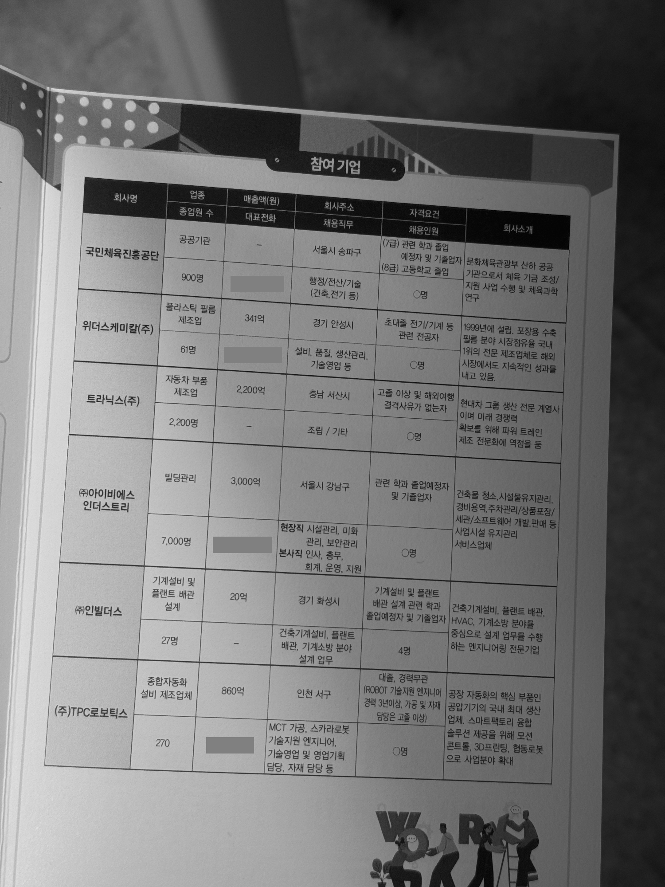 | 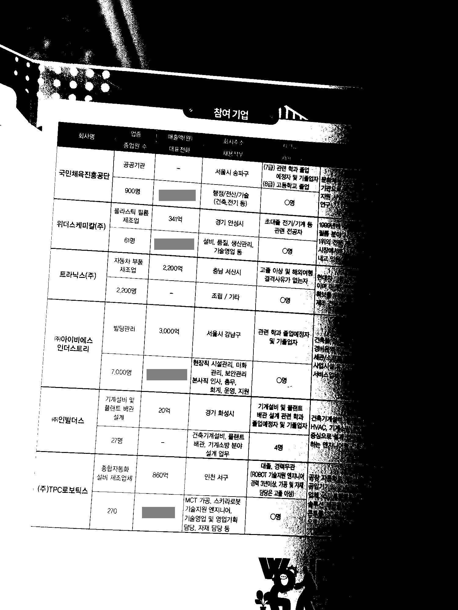 | 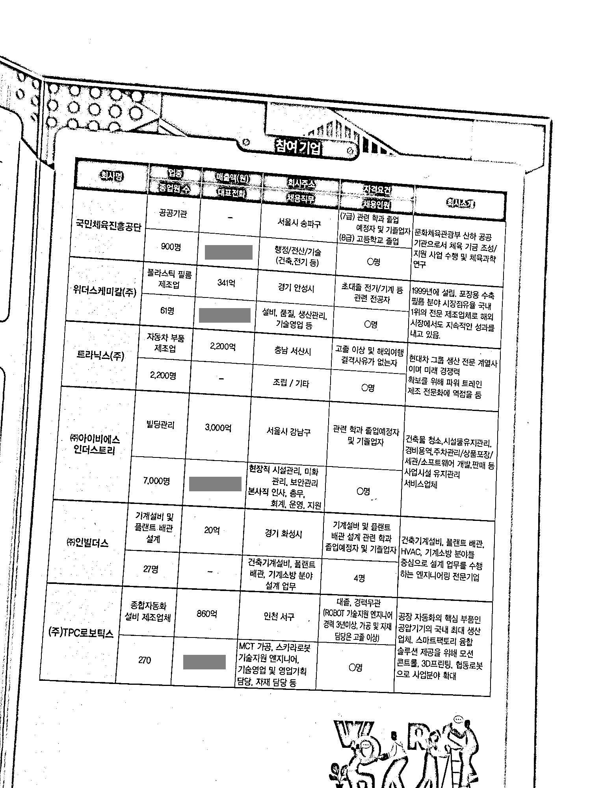 |

**관찰**
- 그림자가 **약할 때(0.2 이하)는 전역 방법이 더 높고**, 0.35부터 고정값이, 0.5부터 Otsu가 급격히 무너집니다.
- 적응형은 강도가 올라가도 0.92 안팎을 유지합니다. 결론은 "항상 낫다"가 아니라 **"그림자가 강해질 때 낫다"** 입니다.
- `blockSize`는 11과 201이 낮고 51 부근이 가장 높았습니다. 글자 크기에 비해 너무 작거나 너무 크지 않아야 합니다.

---

## 19. 한계

- 기준이 **정답 라벨이 아니라 원본의 Otsu 결과**입니다. 그림자가 없을 때 전역 방법에 유리하게 편향되어 있고, 적응형이 0.92 부근에서 더 오르지 않는 것도 이 때문일 수 있습니다.
- 가짜 그림자는 매끈한 직선 그라데이션입니다. 실제 그림자의 불규칙한 경계, 겹친 그림자는 반영하지 못했습니다.
- 평가는 표 안쪽만 대상으로 했고, 배경, 컬러 머리글, 일러스트는 제외했습니다.
- 사진 한 장으로 비교했으므로 다른 문서, 다른 글자 크기에서는 `blockSize`, `C` 최적값이 달라질 수 있습니다.

## 20. 실행 방법

```text
프로젝트 폴더/
├─ 05_adaptive_threshold.py
├─ 06_synthetic_shadow.py
└─ docs/images/document.jpg   (또는 images/document.jpg)
```

```bash
pip install opencv-python numpy
python 05_adaptive_threshold.py
python 06_synthetic_shadow.py
```

결과는 `output/` 폴더에 저장됩니다.

## 21. 이미지 출처와 공개 시 주의

- 입력 사진: 채용박람회 안내 책자를 촬영한 사진입니다.
- 책자에 회사명과 대표전화가 나오므로, `output/`의 전체 페이지 이미지는 **전화번호 칸을 회색 상자로 가렸습니다.** README에는 연락처가 보이지 않는 확대 구간만 사용했습니다.
